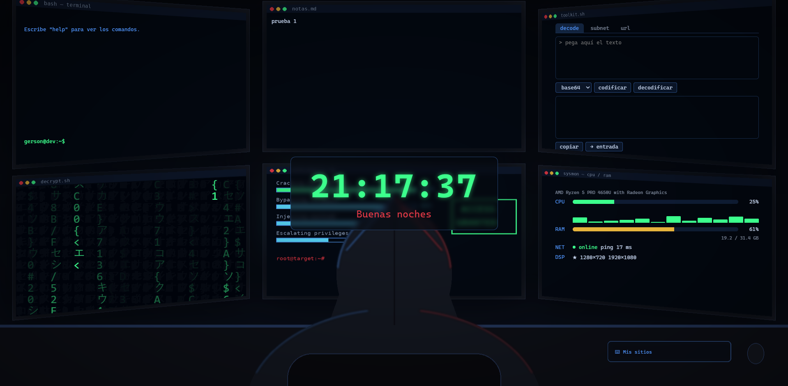

# Mi pantalla — Nueva pestaña hacker para Chrome

Extensión de Chrome que sustituye la página de nueva pestaña por un escritorio de temática hacker: un programador con capucha frente a seis monitores, cinco de ellos **funcionales**.



## Funcionalidades

| Pantalla | Qué hace |
|---|---|
| `bash — terminal` | Terminal de comandos: búsquedas en Google, YouTube, GitHub, MDN y Stack Overflow, y `repo <nombre>` para abrir mis repositorios, con **autocompletado con Tab** desde la API de GitHub. |
| `notas.md` | Notas rápidas que se guardan solas mientras escribes y se sincronizan con la cuenta de Google. |
| `toolkit.sh` | Caja de herramientas de seguridad con tres pestañas: **decode** (base64, hex, ROT13, URL, SHA-256), **subnet** (calculadora de subredes IPv4 con vista binaria) y **url** (analizador de URLs que detecta trucos de phishing y patrones de ataque). |
| `decrypt.sh` | Lluvia de caracteres al estilo Matrix, dibujada en `<canvas>`. |
| `sysmon — cpu / ram` | Uso real de CPU (total y por núcleo), RAM, latencia de red y monitores conectados. |
| Teclado | Desplegable con los marcadores de la barra y los sitios más visitados, con sus favicons. |

Además: reloj en tiempo real con saludo según la hora del día.

Todas las pantallas se recolocan sobre la imagen de fondo al cambiar el tamaño de la ventana, sea cual sea la proporción del monitor.

## Instalación

1. Clona el repositorio:
   ```bash
   git clone https://github.com/Gerpaes/hacker-newtab.git
   ```
2. Abre `chrome://extensions` en Chrome.
3. Activa el **Modo de desarrollador** (arriba a la derecha).
4. Pulsa **Cargar descomprimida** y selecciona la carpeta del proyecto.
5. Abre una pestaña nueva.

También funciona en navegadores basados en Chromium, como Edge o Brave.

## Comandos de la terminal

| Comando | Acción |
|---|---|
| `help` | Lista los comandos |
| `g <texto>` | Busca en Google |
| `yt <texto>` | Busca en YouTube |
| `gh <texto>` | Busca en GitHub |
| `mdn <texto>` | Busca en la documentación de MDN |
| `so <texto>` | Busca en Stack Overflow |
| `repo [nombre]` | Abre uno de mis repositorios (**Tab** autocompleta); sin nombre, abre mi perfil |
| `bandit` | Abre OverTheWire Bandit |
| `clear` | Limpia la terminal |

## Permisos

La extensión pide solo los permisos que necesita (principio de **mínimo privilegio**):

| Permiso | Para qué se usa |
|---|---|
| `topSites` | Leer los sitios más visitados |
| `bookmarks` | Leer la barra de marcadores |
| `favicon` | Mostrar el icono de cada sitio |
| `storage` | Guardar las notas |
| `system.cpu`, `system.memory`, `system.display` | Monitor del sistema |

## Decisiones de seguridad

- **Nada de `innerHTML` con datos externos.** Los títulos de las webs, los nombres de los repositorios y todo lo que se decodifica en el toolkit se pintan con `textContent`, para evitar ataques **XSS**.
- **Sin JavaScript en línea.** Manifest V3 lo bloquea por su política de seguridad de contenido (CSP), así que todo el código está en archivos `.js` externos.
- **Sin tokens ni contraseñas guardados.** El autocompletado de repositorios usa la API pública de GitHub, sin token, y solo muestra repositorios públicos.
- **Las URLs se analizan con el objeto `URL` del navegador**, no con expresiones regulares caseras, que un atacante podría engañar.
- **El toolkit funciona en local:** nada de lo que se codifica, decodifica o analiza sale del navegador.

## Tecnologías y conceptos

- **HTML5 semántico** y accesible: `<details>`, `<output>`, `<dl>`, roles ARIA en las pestañas.
- **CSS:** Flexbox, Grid, `clip-path`, `backdrop-filter`, `clamp()`, variables CSS para las capas de `z-index`.
- **JavaScript:** `async`/`await`, `Promise.all`, `fetch` a una API REST, `requestAnimationFrame`, operaciones bit a bit, Web Crypto API, *debounce*.
- **APIs de extensiones de Chrome:** `topSites`, `bookmarks`, `storage.sync`, `system.cpu`, `system.memory`, `system.display`.

## Estructura

```
├── manifest.json      Configuración y permisos de la extensión
├── newtab.html        Estructura de la página
├── css/style.css      Estilos
├── js/script.js       Lógica de todas las pantallas
├── images/            Imagen de fondo
└── docs/              Capturas para este README
```

## Autor

**Gerson Paredes** — estudiante de Desarrollo de Aplicaciones Web.
[GitHub](https://github.com/Gerpaes) · [LinkedIn](https://www.linkedin.com/in/gerson-dallyn-paredes)
